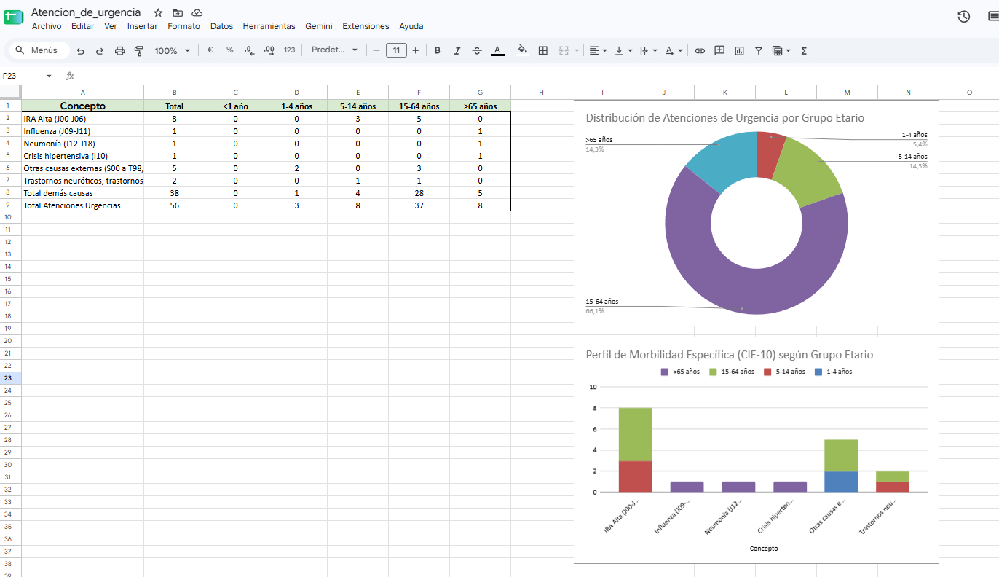

# Análisis Epidemiológico de Atenciones de Urgencia (CIE-10 y Rango Etario)

## 🎯 Objetivo del Proyecto
Analizar la distribución demográfica y el perfil de morbilidad específica según clasificación internacional de enfermedades (`CIE-10`) en un servicio de urgencia de mediana complejidad, transformando reportes estadísticos clínicos en indicadores visuales para la gestión sanitaria.

## 🛠️ Herramientas Utilizadas
* **Google Sheets / Excel:** Estandarización de reportes epidemiológicos (REM), eliminación de subtotales duplicados y visualización de morbilidad por grupo etario.

## 💡 Principales Hallazgos Epidemiológicos
* **Concentración Etaria:** El grupo adulto productivo (**15 a 64 años**) concentra el **66,1% del total de atenciones** (`37` de `56` casos), seguido por población escolar (`5-14 años`) y adultos mayores (`>65 años`) con **14,3%** cada uno, y preescolares (`1-4 años`) con **5,4%**.
* **Predominio Respiratorio y Traumático:** Dentro de las patologías específicas codificadas, las **Infecciones Respiratorias Agudas Altas (`J00-J06`)** lideran la demanda (concentradas entre los `5` y `64` años), seguidas por **causas externas y traumatismos (`S00-T98`)**.
* **Vulnerabilidad en Adultos Mayores (`>65 años`):** Las patologías de mayor complejidad clínica (**Influenza, Neumonía y Crisis Hipertensiva**) se concentran en la población mayor de 65 años, respaldando la necesidad de flujos prioritarios y seguimiento preventivo en este grupo.

### Vista Previa del Dashboard

